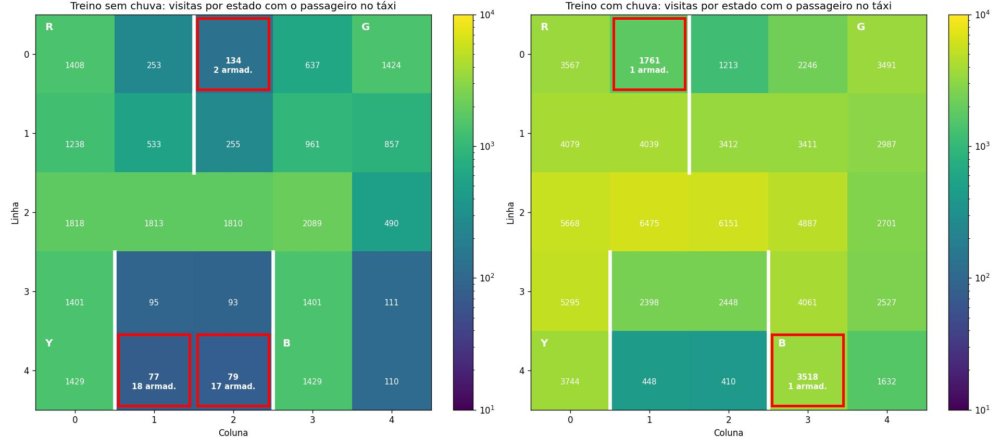

### Projeto 2 de IA e Robótica

### Participantes
- Humberto Filho Castello Branco Lages Rebello e Castro
- Álvaro Souza
- Gabriel Kenji Nakahara Rocha
- Eduardo Khaled Chmouri

## Objetivo

Comparar dois algoritmos de aprendizado por reforço tabular, **Q-learning** e **Sarsa**, no ambiente [Taxi-v4](https://gymnasium.farama.org/environments/toy_text/taxi/) do Gymnasium, em duas versões:

- **Determinística:** o táxi sempre vai para onde quer.
- **Não determinística (com chuva):** `is_rainy=True, rainy_probability=0.6`. O táxi vai para onde quer com 60% de chance; nos outros 40% ele desvia para um dos lados.

O táxi precisa buscar um passageiro e deixá-lo no destino. Cada passo vale −1, entregar o passageiro vale +20 e um pickup ou dropoff no lugar errado vale −10. O ambiente tem 500 estados e 6 ações.

## Estrutura

| Arquivo / pasta | Conteúdo |
|---|---|
| `deterministico.ipynb` | Q-learning e Sarsa sem chuva: treino, curvas de aprendizado, avaliação e comparação |
| `naodeterministico.ipynb` | Os mesmos experimentos com chuva, mais o Item 4 (Q-table sem chuva testada com chuva), o Item 5 (comparação geral) e a conclusão final |
| `experimentos.ipynb` | Experimentos extras: política ótima, decaimento do ε, intensidade da chuva, estados-armadilha e Expected Sarsa |
| `agentes.py` | Implementação de `QLearning`, `Sarsa` e `ExpectedSarsa`, e a função de avaliação usada pelos notebooks |
| `data_*/` | Q-tables treinadas (uma por execução), em CSV |
| `results_*/` | Gráficos de cada execução e rewards por episódio (`.npy`) |
| `results_comparacao_curvas*.jpg` | Curvas de aprendizado Q-learning vs Sarsa |
| `results_experimentos/` | Gráficos do `experimentos.ipynb` |

## Como rodar

Testado com Python 3.13.

```bash
python -m venv .venv
.venv\Scripts\activate          # Windows
# source .venv/bin/activate     # Linux / macOS
pip install -r requirements.txt
```

Depois, abra os notebooks no VS Code ou no Jupyter e rode **nesta ordem**:

1. `deterministico.ipynb` (~1 min)
2. `naodeterministico.ipynb` (~5 min), que usa as Q-tables do determinístico no Item 4
3. `experimentos.ipynb` (~15 min), que usa as Q-tables e os rewards dos dois anteriores

Todas as execuções usam seeds fixas (`seed=run`), então rodar de novo gera exatamente as mesmas Q-tables, gráficos e tabelas.

## Configuração

| Parâmetro | Valor |
|---|---|
| α (taxa de aprendizado) | 0,1 |
| γ (desconto) | 0,99 |
| ε inicial / mínimo | 0,7 / 0,05 |
| Decaimento do ε | × 0,99 por episódio (chega ao mínimo no episódio 264) |
| Episódios de treino | 10.000 sem chuva, 20.000 com chuva |
| Execuções | 5 por algoritmo e ambiente |
| Avaliação | Política gulosa nos mesmos 100 episódios para todos os agentes (máx. 200 passos) |

## Resultados

**Desempenho final** (média das 5 execuções nos mesmos 100 episódios de teste)

| Treinado em | Testado em | Algoritmo | Passos | Reward médio | Não terminou |
|---|---|---|---:|---:|---:|
| Sem chuva | Sem chuva | Q-learning | 13,31 | 7,69 | 0 |
| Sem chuva | Sem chuva | Sarsa | 13,32 | 7,68 | 0 |
| Com chuva | Com chuva | Q-learning | 25,74 | −4,74 | 0 |
| Com chuva | Com chuva | Sarsa | 26,81 | −5,89 | 0,4 |
| Sem chuva | Com chuva | Q-learning | 30,14 | −9,60 | 2,2 |
| Sem chuva | Com chuva | Sarsa | 29,06 | −8,39 | 1,6 |

**Velocidade de aprendizado** (episódio médio em que a média móvel de 100 episódios do reward passou do limiar)

| Ambiente | Algoritmo | Limiar baixo | Limiar alto |
|---|---|---:|---:|
| Sem chuva (0 e 4) | Q-learning | 950 | 1315 |
| Sem chuva (0 e 4) | Sarsa | 1167 | 1447 |
| Com chuva (−20 e −12) | Q-learning | 1476 | 2136 |
| Com chuva (−20 e −12) | Sarsa | 1672 | 2626 |


### Principais conclusões

- **O Q-learning aprende mais rápido** nos dois ambientes, porque o alvo da atualização usa sempre a melhor ação seguinte e a informação sobre bons caminhos se espalha mais rápido pela Q-table.
- **No desempenho final os dois ficam praticamente iguais.** Sem chuva, o Q-learning chega à política ótima nas 5 execuções e o Sarsa fica a no máximo 4 passos dela somando os 100 episódios.
- **A chuva quase dobra o número de passos** e deixa o reward negativo. A meta de reward 8 é inalcançável com chuva: até a política ótima fica em −3,85.
- **Treinar no ambiente certo importa.** A Q-table treinada sem chuva fica presa em ~2% dos episódios quando testada com chuva, porque escolhe andar contra a parede em estados que quase nunca visitou no treino.

## Experimentos extras

O `experimentos.ipynb` aprofunda os resultados:

1. **Política ótima como referência:** calculada por iteração de valor. Confirma que o Q-learning sem chuva é ótimo e que a meta de 8 é a média da política ótima (7,93).
2. **Decaimento do ε:** explorar por mais tempo atrasa a curva de reward do treino, mas quase não muda o que o agente aprende. Por isso a política gulosa é a melhor medida de aprendizado.
3. **Intensidade da chuva:** de `rainy_probability` 0,2 a 1,0. Até 0,6 os agentes ficam perto do ótimo; com chuva mais forte, 20.000 episódios não bastam.
4. **Estados-armadilha:** prova a explicação do Item 4 com as visitas de cada estado no treino.
5. **Expected Sarsa:** terceiro algoritmo, que ficou entre o Q-learning e o Sarsa em velocidade e desempenho.


