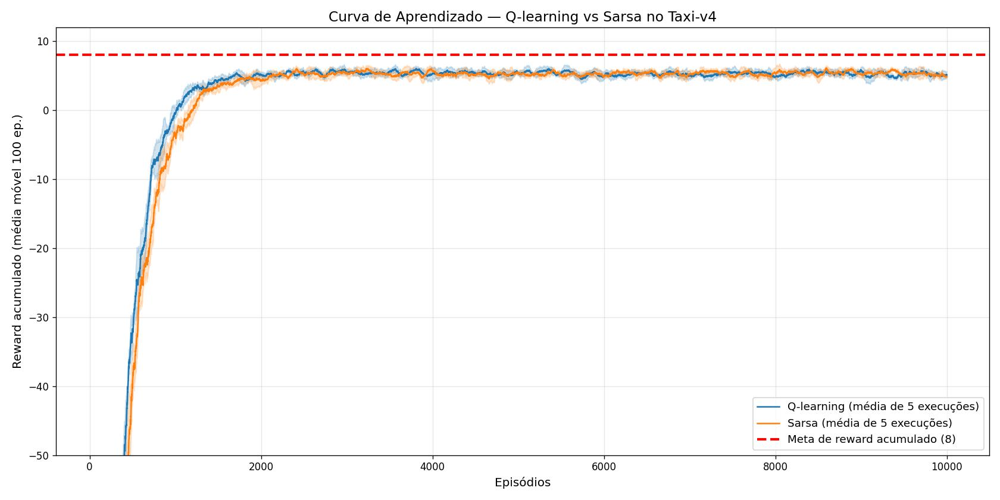
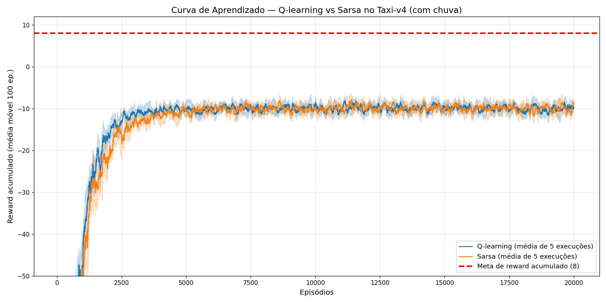

### Projeto 2 de IA e Robótica

### Participantes
- Eduardo Khaled Chmouri
- Humberto Filho Castello Branco Lages Rebello e Castro
- Álvaro Souza
- Gabriel Kenji Nakahara Rocha

## Objetivo

Comparar dois algoritmos de aprendizado por reforço, **Q-learning** e **Sarsa**, no ambiente [Taxi-v4](https://gymnasium.farama.org/environments/toy_text/taxi/) do Gymnasium:

- **Determinístico:** o táxi sempre vai para onde quer.
- **Não determinístico (com chuva):** `is_rainy=True, rainy_probability=0.6`. O táxi vai para onde quer em 60% das vezes e desvia para os lados nas outras 40%.

O táxi precisa buscar um passageiro e levá-lo até o destino. Cada passo vale −1, a entrega vale +20 e um pickup ou dropoff no lugar errado vale −10.

## Arquivos

| Arquivo / pasta | Conteúdo |
|---|---|
| `deterministico.ipynb` | Q-learning e Sarsa sem chuva |
| `naodeterministico.ipynb` | Q-learning e Sarsa com chuva, Item 4, Item 5 e conclusão final |
| `experimentos.ipynb` | Experimentos extras: decaimento do ε e intensidade da chuva |
| `agentes.py` | Classes `QLearning` e `Sarsa` e a função de avaliação |
| `data_*/` | Q-tables treinadas (uma por execução) |
| `results_*/` | Gráficos de cada execução |

## Como rodar

```bash
python -m venv .venv
.venv\Scripts\activate
pip install -r requirements.txt
```

Depois abra os notebooks no VS Code (ou no Jupyter) e rode nesta ordem: `deterministico.ipynb`, `naodeterministico.ipynb` (usa as Q-tables do determinístico no Item 4) e `experimentos.ipynb`. Todas as execuções usam seed, então os resultados se repetem.

## Parâmetros

α = 0,1 · γ = 0,99 · ε de 0,7 até 0,05 (× 0,99 por episódio) · 10.000 episódios sem chuva e 20.000 com chuva · 5 execuções por algoritmo · teste em 100 episódios sem ações aleatórias.

## Resultados

| Treinado em | Testado em | Algoritmo | Passos | Reward médio | Não terminou |
|---|---|---|---:|---:|---:|
| Sem chuva | Sem chuva | Q-learning | 13,31 | 7,69 | 0 |
| Sem chuva | Sem chuva | Sarsa | 13,32 | 7,68 | 0 |
| Com chuva | Com chuva | Q-learning | 25,74 | −4,74 | 0 |
| Com chuva | Com chuva | Sarsa | 26,81 | −5,89 | 0,4 |
| Sem chuva | Com chuva | Q-learning | 30,14 | −9,60 | 2,2 |
| Sem chuva | Com chuva | Sarsa | 29,06 | −8,39 | 1,6 |

"Não terminou" é a média, por execução, de episódios de teste (em 100) que passaram do limite de 200 passos.




## Conclusões

- **O Q-learning aprende mais rápido** nos dois ambientes, porque atualiza a Q-table usando sempre a melhor ação do próximo estado.
- **No resultado final os dois ficam praticamente iguais.**
- **A chuva quase dobra o número de passos** e deixa o reward negativo, então a meta de 8 não é alcançada com chuva.
- **Treinar no ambiente certo importa:** a Q-table treinada sem chuva, testada com chuva, fica presa em ~2% dos episódios.
